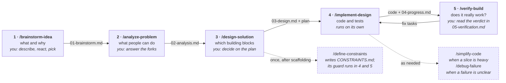

# Agent Skills

A personal Claude Code plugin marketplace, `adh-agent-utils`, holding reusable
utilities for setting up and configuring a development environment.

## Install

Add the marketplace, then install the plugin:

```
/plugin marketplace add adrianhdezm/agent-skills
/plugin install dev-setup@adh-agent-utils
```

## Layout

```
.claude-plugin/marketplace.json     marketplace definition, lists every plugin
plugins/<plugin>/
  .claude-plugin/plugin.json        plugin manifest (metadata, MCP servers)
  skills/<skill>/
    SKILL.md                        the skill itself; frontmatter name + description
    scripts/                        files the skill installs or runs
    references/                     detail loaded on demand
```

## Plugins

### `dev-setup`

Skills for configuring a machine with Claude Code — hooks, guardrails, and
tooling conventions — plus five phase skills that take a project from idea to
a verified build (see [From idea to verified build](#from-idea-to-verified-build)).

| Skill                       | What it does                                                                                                                                                                                                               |
| --------------------------- | -------------------------------------------------------------------------------------------------------------------------------------------------------------------------------------------------------------------------- |
| `analyze-problem`           | Phase 2: interviews fork by fork and writes a framework-free analysis with numbered behaviours (B1…) and testable acceptance criteria (B1.1…)                                                                              |
| `apply-stack-conventions`   | Resolves the stack, lists the concept, technology, integration and example docs that apply, and assembles `coding-conventions.md` for the calling skill                                                                    |
| `bootstrap-project`         | Scaffolds a project from a short interview by looking up the stack conventions for each technology, pairing and starter example, filling gaps with reported defaults; every check passing                                  |
| `brainstorm-idea`           | Phase 1: collects the idea and its references, proposes directions that differ in kind, optionally tests the riskiest assumption with a throwaway PoC, and records the chosen direction                                    |
| `confirm-my-goal`           | Plays back the goal, problem and scope in its own words, flags assumptions, and waits for confirmation before acting; runs only via `/confirm-my-goal`                                                                     |
| `debug-failure`             | Finds the root cause of a failure: reproduces it, narrows it down (bisecting a regression), writes a failing test, fixes the cause and proves it with every check                                                          |
| `define-constraints`        | Writes the project's quality bar into `CONSTRAINTS.md` (floor, checks with commands, measured values, done means, boundaries), wires `check:fast` / `check:task` / `check:full`, and guards the diff against a lowered bar |
| `design-solution`           | Phase 3: maps each behaviour onto the project's real building blocks, puts the open forks on an interactive HTML plan, and writes the decisions and ordered vertical slices; scaffolds first when no code exists           |
| `implement-design`          | Phase 4: builds the design slice by slice, with one test per criterion titled by its ID and a progress checklist that survives new sessions                                                                                |
| `simplify-code`             | Makes recently changed code easier to read without changing behaviour, one change at a time with the tests run after each; leaves `simplify-ignore` blocks alone                                                           |
| `setting-up-git-guardrails` | Installs a PreToolUse hook that blocks destructive git commands (force-push, `reset --hard`, `clean -f`, `branch -D`, whole-tree `checkout`/`restore`)                                                                     |
| `setting-up-npm-block`      | Installs a PreToolUse hook that redirects `npm` to `pnpm`, active only in repos with a `pnpm-lock.yaml`                                                                                                                    |
| `verify-build`              | Phase 5: traces each criterion to a test, runs every check, exercises each behaviour in the running app, checks design conformance and reviews the diff; failures become fix tasks                                         |
| `writing-a-skill`           | Guidance for authoring new skills                                                                                                                                                                                          |

The plugin also registers the `chrome-devtools` MCP server.

## From idea to verified build

Five skills, one for each phase. You run each one yourself with its slash command; none of them starts on its own.
Each one writes a file into `docs/<slug>/` and the next one reads it, so you can stop after any phase and pick it up in
a new session.



Solid boxes are the five phases, and the label on each arrow is the file that phase leaves in `docs/<slug>/`. Dashed
boxes are the supporting skills a phase calls.

You stay in the loop where your judgement matters: the interviews in the first two phases, and the decisions on the
design plan. Implementation runs on its own and stops only when it is blocked, or before anything on the project's
"Ask first" list or anything destructive.

Three supporting skills plug into the phases. You can also run each of them on its own:

| Skill                 | Where the phases use it                                                                         |
| --------------------- | ----------------------------------------------------------------------------------------------- |
| `/define-constraints` | Design runs it once, right after scaffolding. Implement and verify run its guard                |
| `/simplify-code`      | Implement runs it at the end of a slice, when the code works but is heavier than it needs to be |
| `/debug-failure`      | Implement runs it when a check fails and the cause is not plain from the first error            |

### Before you start

- Install the plugin (see [Install](#install)). Consider `setting-up-git-guardrails` first, since the implementation
  phase runs commands without asking each time.
- Have Node 24+ and pnpm 11+. For a full-stack app, have Docker running.
- Pick a **slug** for the initiative: `v1` for a first version, or a feature name such as `billing` later. Every file
  of the initiative lives in `docs/<slug>/`.
- You do not need a repo yet. The first phase creates the project folder if there is none, and the design phase
  scaffolds the code.

### 1. Brainstorm: `/brainstorm-idea <slug>`

**You:** describe the idea in your own words, who has the problem, and anything that inspires it: links, screenshots,
products you like. Then react to the directions Claude proposes, and pick one.

**Claude:** reads your references and proposes 3 to 5 directions that differ in kind, at least one of them unusual,
each with its riskiest assumption. If one assumption can be tested in about half an hour of code, it offers a
throwaway proof of concept in `${CLAUDE_PLUGIN_DATA}/sandbox/<slug>-poc`, outside your project.

**You get:** `01-brainstorm.md`, with your words quoted, the directions considered, what the PoC showed, and the
chosen direction with the ones you dropped.

### 2. Analyze: `/analyze-problem <slug>`

**You:** approve the list of behaviours, then answer the forks one at a time. Each fork comes with a recommended
default, so "yes, the default" is a fine answer.

**Claude:** turns the direction into behaviours a person can see, with no frameworks, tables or endpoints. Each
behaviour gets an ID and acceptance criteria:

```markdown
### B3: A teammate can vote for one place and change their vote.

- B3.1 Given an open poll, when a teammate votes for a place, then its count goes up by one and it shows as their vote.
- B3.2 Given a teammate voted for A, when they vote for B, then A goes down by one and B goes up by one.
```

**You get:** `02-analysis.md`, with actors, behaviours, the domain in plain words, flows, screens, constraints,
non-goals, and a **Later** list so the first version stays small.

### 3. Design: `/design-solution <slug>`

**You:** if the project has no code yet, pick the stack first: Claude recommends a combination from the
`bootstrap-project` interview (a Node package, a Hono Worker, a REST API on Node with Express or Hono, React Router on Workers or on Node, an
Angular app or the Angular full stack, or your own). Then open the interactive plan, answer its 2 to 5 decisions, comment on any
claim, press **Respond**, and paste the result back into the chat.

**Claude:** scaffolds the project if needed, and runs `/define-constraints` to write the quality bar into
`CONSTRAINTS.md` (four questions, each with a default; "the floor only" is a fine answer). Then it maps every behaviour
onto the project's real building blocks: tables and migrations, data access, contracts, routes, state, components, and
the test tier for each criterion. It follows the project's conventions file (such as `coding-conventions.md` from
`bootstrap-project`), decides the contract, UI and security rules for each behaviour, and checks the official docs
for any API it is unsure of. It cuts the work into small **vertical slices**, each one visible end to end when it is
done, with the riskiest one early, and builds the plan page. A script checks that every behaviour is covered.

**You get:** `CONSTRAINTS.md` if the project had none, `03-design.md` (decisions, schema, contracts, modules, ordered
slices, risks, sources) and `03-design.html`, the review
page, published as a private artifact. The design is marked `Approved` once nothing is open.

### 4. Implement: `/implement-design <slug> [S2 | all]`

**You:** start it, and read `04-progress.md` instead of the scrollback when you want to know where it stands. Say
"commit each slice" if you want commits. Without that, nothing is committed.

**Claude:** builds one slice at a time. It writes the slice's checklist first, then writes each test before or with
its code, titled with the criterion ID (`it("B3.2 moves my vote from A to B", …)`). It runs `check:fast` after each
item, uses `/debug-failure` when a failure is not plain, and closes the slice only when `check:task` passes and the
guard finds no lowered bar (no new suppressions, skipped tests or removed assertions). If the code is heavier than it
needs to be, it runs `/simplify-code` on the slice. It touches only what the slice needs and lists anything else it
noticed. A small departure from the design is recorded as a deviation. A change to behaviour, contract or data stops
the run and asks you first.

**You get:** working code and tests, plus `04-progress.md` with ticked checklists, decisions, deviations and anything
it found.

### 5. Verify: `/verify-build <slug>`

**You:** read the verdict and the "Not confirmed" and "Not blocking" lists, and decide what to do about them.

**Claude:** checks what green tests alone do not prove:

- traces every criterion ID to the tests that name it, and reads those tests;
- runs every project check (`check:full`), the guard, and the **Done means** list from `CONSTRAINTS.md`;
- starts the app and walks each behaviour as a user would, in the browser through the `chrome-devtools` MCP server,
  saving a screenshot as evidence;
- checks that each design decision is honoured, with `file:line`;
- reviews the diff across correctness, readability, architecture, security and performance, labelling each finding
  **Critical** or **Required** (blocks) or **Optional** or **Nit** (does not).

It changes no code. Each failure becomes a task under **Fixes from verification** in `04-progress.md`.

**You get:** `05-verification.md` with a verdict (**Ready**, **Ready with fixes** or **Not ready**), a table of every
criterion with its test, its live result and its evidence, and screenshots in `evidence/`. If there are fixes, run
`/implement-design <slug>` again: it starts with them. Then verify again.

### How the IDs tie it together

The IDs from the analysis carry through every phase, so nothing gets lost between them:

| Phase     | What happens to B3.2                                                                 |
| --------- | ------------------------------------------------------------------------------------ |
| Analyze   | written as a criterion: "Given a teammate voted for A, when they vote for B, …"      |
| Design    | B3 is listed on slice S2, and B3.2 gets a test tier (integration)                    |
| Implement | the test is titled `B3.2 moves my vote from A to B`                                  |
| Verify    | traced to `tests/app.test.ts`, walked in the browser, screenshot `evidence/B3.2.png` |

### What a finished initiative looks like

```
docs/v1/
├── 01-brainstorm.md
├── 02-analysis.md
├── 03-design.md
├── 03-design.plan.json     the plan's data; 03-design.html is built from it
├── 03-design.html
├── 04-progress.md
├── 05-verification.md
└── evidence/
    ├── B1.2.png
    └── …
```

### Tips

- **Every run ends the same way**, with three headings: **Blocked on me**, **Changed** and **Found**, then the command
  to run next. Read **Blocked on me** first.
- **Keep the first version small.** Push ideas to **Later** in the analysis. The next initiative can pick them up.
- **"Not opened; default kept"** in a plan response means you did not look at that decision. Claude will ask about it
  in chat if it matters.
- **Changing your mind** about a behaviour means updating the analysis. IDs never get renumbered: a removed behaviour
  is marked _(dropped)_, and a new one gets the next number.
- **Never lower the bar to get to green.** If a check in `CONSTRAINTS.md` is wrong, change it in its own commit, with
  a reason, or add an exception with an owner and an expiry date.
- **The next initiative** starts again at `/brainstorm-idea` with a new slug, in the same repo. Earlier initiatives'
  docs stay as they are.
