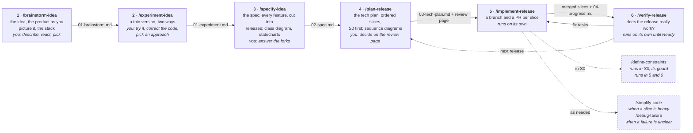
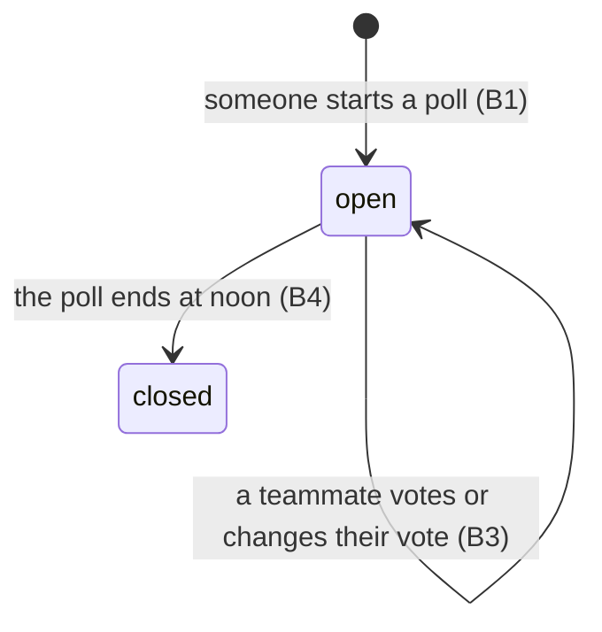

# Agent Skills

A personal Claude Code plugin marketplace, `adh-agent-utils`, holding reusable
utilities for setting up and configuring a development environment.

## Install

Add the marketplace, then install the plugin:

```
/plugin marketplace add adrianhdezm/agent-skills
/plugin install dev-setup@adh-agent-utils
```

## Layout

```
.claude-plugin/marketplace.json     marketplace definition, lists every plugin
plugins/<plugin>/
  .claude-plugin/plugin.json        plugin manifest (metadata, MCP servers)
  skills/<skill>/
    SKILL.md                        the skill itself; frontmatter name + description
    scripts/                        files the skill installs or runs
    references/                     detail loaded on demand
```

## Plugins

### `dev-setup`

Skills for configuring a machine with Claude Code — hooks, guardrails, and
tooling conventions — plus six phase skills that take a project from idea to
a verified release (see [From idea to verified release](#from-idea-to-verified-release)).

| Skill                     | What it does                                                                                                                                                                                                                                                  |
| ------------------------- | ------------------------------------------------------------------------------------------------------------------------------------------------------------------------------------------------------------------------------------------------------------- |
| `apply-stack-conventions` | Resolves the stack from a project or a combination through its knowledge graph of concepts, technologies, integrations, examples and stacks, assembles `coding-conventions.md` for the calling skill, and answers which rules govern a file or a topic |
| `bootstrap-project`       | Scaffolds a project from a short interview by looking up the stack conventions for each technology, pairing and starter example, filling gaps with reported defaults; every check passing                                                                     |
| `brainstorm-idea`         | Phase 1: collects the idea, the product as you picture it, the stack constraints and references, proposes directions that differ in kind, and records the chosen one                                                                                          |
| `confirm-my-goal`         | Plays back the goal, problem and scope in its own words, flags assumptions, and waits for confirmation before acting; runs only via `/confirm-my-goal`                                                                                                        |
| `debug-failure`           | Finds the root cause of a failure: reproduces it, narrows it down (bisecting a regression), writes a failing test, fixes the cause and proves it with every check                                                                                             |
| `define-constraints`      | Writes the project's quality bar into `CONSTRAINTS.md` (floor, checks with commands, measured values, done means, boundaries), wires `check:fast` / `check:task` / `check:full`, and guards the diff against a lowered bar                                    |
| `experiment-idea`         | Phase 2: builds a thin, throwaway version of the idea in two approaches within the stack constraints, compares them, and records your code corrections (C1…)                                                                                                  |
| `implement-release`       | Phase 5: builds the release slice by slice, each on its own branch and pull request, following each slice's sequence diagram, with one test per criterion titled by its ID; goes on to verify                                                                 |
| `load-keychain-secrets`   | Copies secrets from the macOS Keychain into a project's or sandbox's `.env` by name, git-ignoring the file first; the values never pass through the conversation                                                                                              |
| `plan-release`            | Phase 4: the release's tech lead: maps each behaviour onto real building blocks, draws the modules (class diagram) and each slice's path (sequence diagram), puts the forks on an interactive review page, and orders the slices, with an S0 setup task first |
| `set-up-dev-machine`      | Installs the git guardrails hook (blocks force-push, `reset --hard`, `clean -f`, `branch -D`, whole-tree `checkout`/`restore`) and the npm-to-pnpm hook, and gets `gh` installed and logged in                                                                |
| `simplify-code`           | Makes recently changed code easier to read without changing behaviour, one change at a time with the tests run after each; leaves `simplify-ignore` blocks alone                                                                                              |
| `specify-idea`            | Phase 3: writes the spec: every feature as numbered behaviours (B1…) with testable acceptance criteria (B1.1…), cut into releases (R1…), the domain as a class diagram and each lifecycle as a statechart, framework-free                                     |
| `verify-release`          | Phase 6: traces each criterion to a test, runs every check, exercises each behaviour in the running app, checks the code against the diagrams and reviews the diff; works the fixes until Ready                                                               |
| `writing-a-skill`         | Guidance for authoring new skills                                                                                                                                                                                                                             |

The plugin also registers the `chrome-devtools` MCP server.

## From idea to verified release

Six skills, one for each phase: explore the idea (brainstorm, experiment), write it down (specify, plan), then build
and prove it (implement, verify). You start each one with its slash command. The last two hand over to each other:
`/implement-release <slug> all` builds a whole release and goes on to verify it, and verification works its own fixes
until the release is ready. Each phase writes a file into `docs/<slug>/` and the next one reads it, so you can stop
after any phase and pick it up in a new session. When you start with no repo, that folder lives in the plugin's data
until the planning phase gives the project its repo.



Solid boxes are the six phases, and the label on each arrow is the file that phase leaves in `docs/<slug>/`. Dashed
boxes are the supporting skills a phase calls. The spec covers the whole idea; plan, implement and verify
then go round once per release.

You stay in the loop where your judgement matters: the interviews, trying the prototypes and correcting their code,
and the decisions on the review page. Implementation and verification run on their own and stop only when they are
blocked, before anything on the project's "Ask first" list or anything destructive, or when a failure needs your
decision.

Three supporting skills plug into the phases. You can also run each of them on its own:

| Skill                 | Where the phases use it                                                                         |
| --------------------- | ----------------------------------------------------------------------------------------------- |
| `/define-constraints` | Implement runs it in the S0 setup slice. Implement and verify run its guard                     |
| `/simplify-code`      | Implement runs it at the end of a slice, when the code works but is heavier than it needs to be |
| `/debug-failure`      | Implement runs it when a check fails and the cause is not plain from the first error            |

### Before you start

- Install the plugin (see [Install](#install)). Run `/set-up-dev-machine` first: its git guardrails matter because the
  implementation phase runs commands without asking each time, and it gets `gh` logged in for the planning and
  implementation phases.
- Have Node 24+ and pnpm 11+. For a full-stack app, have Docker running. Have `gh` installed and logged in: the planning
  phase finds or creates the repo with it, and the implementation phase opens and merges a pull request per slice.
- Pick a **slug** for the initiative: `v1` for a first version, or a feature name such as `billing` later. Every file
  of the initiative lives in `docs/<slug>/`.
- You do not need a repo yet. Start the brainstorm in the project's repo when there is one, and its docs go in
  `docs/<slug>/` there. Start it anywhere else, and they go in an idea folder,
  `${CLAUDE_PLUGIN_DATA}/ideas/<slug>/`, where you can also drop notes and screenshots under `references/`. The planning
  phase then finds the repo the idea belongs to, or creates a new one with the GitHub CLI, and moves the folder into
  it.

### 1. Brainstorm: `/brainstorm-idea <slug>`

**You:** describe the idea in your own words, who has the problem, and anything that inspires it: links, screenshots,
products you like. Say how you picture the product (the first moment someone uses it, the screens that matter) and
what the stack must be or avoid, such as "a web app on Cloudflare". Then react to the directions Claude proposes, and
pick one.

**Claude:** reads your references, and what earlier initiatives handed on (their **Next initiative**, **Later** and
**Not doing** lists), and proposes 3 to 5 directions that differ in kind, at least one of them unusual,
each with its riskiest assumption. It records the stack you stated, and picks no framework for you.

**You get:** `01-brainstorm.md`, with your words quoted, the **Product concept** and the **Stack constraints**, the
directions considered, the chosen direction with the ones you dropped, and the assumptions it bets on, riskiest first.

### 2. Experiment: `/experiment-idea <slug>`

**You:** agree the thin path, the questions, the approaches, what gets mocked and the time box. Then try each
prototype, read its code and change what you would do differently, or tell Claude what to change. Pick the approach.

**Claude:** builds the **thin path** of your product concept (three to six steps, everything else faked) in two
approaches that differ in shape within your stack constraints: on Cloudflare, say, a server-rendered Worker over D1
against a React Router app with a Durable Object per potluck. Each lives in
`${CLAUDE_PLUGIN_DATA}/sandbox/<slug>-experiment/<approach>/`, outside your project, on a `bootstrap-project` scaffold
when the constraints name a platform. Before it builds, it turns each assumption into a yes/no question with what would
count as a yes and a no written down. Every external service (payments, maps, an LLM, a partner API) sits behind an
interface with a mock strategy, so the prototypes run with no accounts or keys. It snapshots the built code with a
sandbox-only `git init`, so after you edit it, the diff shows every **correction** (C1, C2, …), each recorded with your
reason and its kind: behaviour (the spec takes it), architecture (the tech plan follows it) or convention (S0 writes it into
the conventions file). On a "no" to the riskiest question in every approach, it offers to go back to the brainstorm.

**You get:** `01-experiment.md`, with the thin path, each question answered per approach and what showed it, a
comparison, the chosen approach, your corrections, what each mock pretended, and what the spec and the tech plan must
take from it. The answered assumptions are ticked in `01-brainstorm.md`.

### 3. Specify: `/specify-idea <slug>`

**You:** approve the list of behaviours, the releases and the diagrams, then answer the forks one at a time. Each fork comes with a
recommended default, so "yes, the default" is a fine answer.

**Claude:** writes the spec: every feature the idea needs (a whole product or one feature of one), not only the first release,
as behaviours a person can see, with no frameworks, tables or endpoints. Each behaviour gets an ID and acceptance
criteria:

```markdown
### B3: A teammate can vote for one place and change their vote.

- B3.1 Given an open poll, when a teammate votes for a place, then its count goes up by one and it shows as their vote.
- B3.2 Given a teammate voted for A, when they vote for B, then A goes down by one and B goes up by one.
```

Then it cuts them into **releases**, in the order they ship. R1 is the smallest set someone would use for real,
usually the experiment's thin path plus what makes it safe:

```markdown
## Releases

- **R1: First poll**: B1, B2, B3 · a team picks lunch in one poll
- **R2: Regulars**: B4, B5 · favourite places come back each week
```

Every open question from the brainstorm gets an answer here, each behaviour correction from the experiment becomes a
behaviour or a criterion, and each assumption still untested is listed as a constraint, with the stack constraints.
A script then checks the file: the shape the later scripts read, unique IDs with no gaps, Given/When/Then in every
criterion, every behaviour in exactly one release, and that no ID disappeared since the last commit.

It draws the domain as a Mermaid **class diagram** (the things the system knows, in plain words, with multiplicities)
and each thing whose state changes as a **statechart**, every transition citing the behaviour that causes it. GitHub
draws both, and a state nobody can reach or leave shows a missing behaviour before anyone builds it:



The script also checks that both kinds of diagram are there and that every transition cites a live behaviour.

**You get:** `02-spec.md`, with goals and how to tell they worked, actors, behaviours, releases, the domain class
diagram, the lifecycle statecharts, flows, screens, constraints and non-goals.

### 4. Plan: `/plan-release <slug> [R1]`

**You:** if the docs are still in the idea folder, pick the repo first: one of yours that Claude found with `gh`, or a
new private one. If the project has no code yet, confirm the stack, which usually comes straight from the approach you
picked in the experiment. Then open the interactive review page, answer its 2 to 5 decisions, comment on any claim and press
**Respond**. Then press **Send to Claude**, or copy the response and paste it into the chat.

**Claude:** acts as the tech lead for one release (the first not yet planned, unless you name one). It clones the
repo, or creates it with `gh repo create`, and moves the idea folder into its `docs/<slug>/`, leaving a `MOVED.md`
behind. It maps every behaviour of the release onto the project's real building blocks: tables and migrations, data
access, contracts, routes, state, components, and the test tier for each criterion. It follows the project's
conventions file, or, before there is code, the conventions and starter examples of the chosen stack; honours each
architecture and convention correction from the experiment by its C number; decides the contract, UI and security rules
for each behaviour; and checks the official docs for any API it is unsure of. It cuts the release into ordered tasks,
small **vertical slices**, each visible end to end when it is done, with the riskiest one early. When the project is
not set up yet, the first task is **S0**: the scaffold through `bootstrap-project`, `CONSTRAINTS.md` through
`/define-constraints`, the check scripts, and a CI workflow that runs them on every pull request. It draws the
modules as a Mermaid **class diagram** and each slice's path through them as a **sequence diagram**, failure paths
included, and puts each sequence on the review page next to the claim it explains. A script checks that
every behaviour of the release sits in one claim and one slice, that no slice holds a later release's behaviour, that
every criterion has one test tier, that S0 comes first, that no slice depends on a later one, and that the diagrams
are there. Once you approve, it
commits the docs on the default branch.

**You get:** `03-tech-plan.md` (decisions, what it takes from the experiment, schema, contracts, the modules class
diagram, ordered slices each with its sequence diagram,
risks, sources, and the base commit, or `after S0`) and the release's review page, `03-tech-plan.R1.review.html`, published as a
private artifact. The tech plan is marked `Approved` once nothing is open. A later release adds its decisions and slices
to the same file.

### 5. Implement: `/implement-release <slug> [S2 | fixes | all] [local | no commits]`

**You:** start it, usually with `all`, and read `04-progress.md` instead of the scrollback when you want to know where
it stands. Add `local` to merge without pushing, or `no commits` to leave everything uncommitted.

**Claude:** builds one slice at a time, each on its own branch (`<slug>/s2-…`) from an up to date default branch. S0
goes first when the plan has one; after it merges, the plan's `Base:` is set to that commit, the point every later
diff and guard run starts from. For each slice it writes the checklist first, then builds the path its sequence diagram draws, writing each test before or with its
code, titled with the criterion ID (`it("B3.2 moves my vote from A to B", …)`). It runs `check:fast` after each item,
and uses `/debug-failure` when a failure is not plain. It closes the slice only when `check:task` passes, the tests of
every tier the slice's criteria use have run (end to end included), every criterion has a titled test, the guard finds
no lowered bar since the base (no new suppressions, skipped tests or removed assertions), and no checklist item is
open. If the code is heavier than it needs to be, it runs `/simplify-code` on the slice. Then it pushes the branch,
opens a pull request with `gh`, waits for CI, and squash-merges it. It touches only what the slice needs and lists
anything else it noticed. A small departure from the plan is recorded as a deviation, and the diagram it touches is
updated. A change to behaviour,
contract or data stops the run and asks you first. With `all`, when the release's last slice merges, it goes straight
on to verification.

**You get:** one merged pull request per slice, working code and tests on the default branch, plus `04-progress.md`
with ticked checklists, the PR of each slice, decisions, deviations and anything it found. With no slice named, it
starts with any open fixes from verification, then the next slice.

### 6. Verify: `/verify-release <slug> [R1 | S2] [--since <commit>] [--once]`

**You:** read the verdict and the "Not confirmed" and "Not blocking" lists, and decide what to do about them.

**Claude:** checks what green tests alone do not prove, for the release, on the default branch:

- traces every criterion ID of the release to the tests whose titles name it, and reads those tests;
- runs every project check (`check:full`), the guard since the plan's base, and each item of the **Done means**
  list from `CONSTRAINTS.md`;
- starts the app and walks each behaviour as a user would, in the browser through the `chrome-devtools` MCP server,
  saving a screenshot as evidence;
- checks that each decision is honoured, and that the code matches the class diagram, each slice's sequence
  diagram and the release's statechart transitions, with `file:line`;
- reviews the diff in a fresh subagent that never saw the progress notes, across correctness, readability,
  architecture, security and performance, labelling each finding **Critical** or **Required** (blocks) or
  **Optional** or **Nit** (does not).

It changes no code before the verdict is written. Each failure becomes a checklist item under **Fixes from
verification** in `04-progress.md`. Then it **continues**: it builds the fixes on their own branch the way
implementation does, merges them, and verifies again with `--since`, walking only the behaviours the fixes touched, as
a new row in the file's **Runs** table. It stops at **Ready**, after three rounds that do not get there, or at a
failure only you can decide. `--once` writes the verdict and stops. On **Ready** it closes the release: accepted
deviations go into the tech plan, accepted gaps are listed, and it names the next release to plan. After the last
release, a **Next initiative** section hands the Later list and untested assumptions to the next brainstorm.

**You get:** `05-verification.md` with a verdict (**Ready**, **Ready with fixes** or **Not ready**), a table of every
criterion with its test, its live result and its evidence, screenshots in `evidence/`, and a row per round in the
**Runs** table.

### How the IDs tie it together

The IDs carry through every phase, so nothing gets lost between them:

| Phase      | What happens                                                                                       |
| ---------- | -------------------------------------------------------------------------------------------------- |
| Experiment | you rename a route handler and say why: correction C2 (architecture)                               |
| Specify    | B3.2 written as a criterion: "Given a teammate voted for A, when they vote for B, …"; B3 is in R1  |
| Plan       | B3 is listed on slice S2, B3.2 gets a test tier (integration), and D4 honours C2                   |
| Implement  | S2 is built on `v1/s2-…`; the test is titled `B3.2 moves my vote from A to B`; PR #3 merges        |
| Verify     | B3.2 traced to `tests/app.test.ts`, walked in the browser, screenshot `evidence/B3.2.png`; R1 Ready |

### What a finished initiative looks like

```
docs/v1/
├── 01-brainstorm.md
├── 01-experiment.md
├── 02-spec.md
├── 03-tech-plan.md
├── 03-tech-plan.R1.review.json  each release's review data; its .html page is built from it
├── 03-tech-plan.R1.review.html
├── 03-tech-plan.R2.review.json
├── 03-tech-plan.R2.review.html
├── 04-progress.md
├── 05-verification.md
└── evidence/
    ├── B1.2.png
    └── …
```

The brainstorm and the experiment share the `01` prefix: together they explore the idea before anything is specified.

### Tips

- **Where does it stand?** `node <plugin>/skills/implement-release/scripts/progress.mjs docs/<slug>` prints the
  Status line of each phase file, each slice's state and open items, each release with its slices, and what comes
  next.
- **Every run ends the same way**, with three headings: **Blocked on me**, **Changed** and **Found**, then the command
  to run next. Read **Blocked on me** first.
- **Keep R1 small, not the spec.** Describe every feature in the spec; let the releases decide what ships
  first.
- **Correct the prototype's code freely.** It is throwaway, and every edit you make there becomes a recorded
  correction that the spec and the tech plan must honour.
- **"Not opened; default kept"** in a review response means you did not look at that decision. Claude will ask about it
  in chat if it matters.
- **Changing your mind** about a behaviour means updating the spec. IDs never get renumbered: a removed behaviour
  is marked _(dropped)_, and a new one gets the next number. A behaviour whose meaning changes gets a new number too.
- **Never lower the bar to get to green.** If a check in `CONSTRAINTS.md` is wrong, change it in its own commit, with
  a reason, or add an exception with an owner and an expiry date.
- **The next initiative** starts again at `/brainstorm-idea` with a new slug, in the same repo. Earlier initiatives'
  docs stay as they are, and the brainstorm reads what they handed on.
