# Specify Idea

Phase 3 of 6: brainstorm → experiment → **specify** → plan → implement → verify.

This is the product manager's phase. The experiment showed the idea working thinly; this phase writes the spec: every feature the idea needs, as the people who use it see it: what they can do, what the system knows, how each thing moves through its states, and what must stay true. Then it cuts the features into releases, so planning and the build can take them one at a time. The idea may be a whole product (`v1`) or one feature of a product that exists (`billing`); either way the spec covers all of it. It names no framework, table, endpoint or file. Those are building blocks, and building blocks belong to the planning phase.

**Done means:** every behaviour in `docs/<slug>/02-spec.md` can be judged true or false, has acceptance criteria a test can check, ships in exactly one release, the domain is drawn as a class diagram and each thing whose state changes as a statechart, the user approved the list, the releases and the diagrams with an explicit yes, and `check-spec.mjs` reports no errors.

## When not to use

- A one-line change or a bug: go straight to the code, or to `/debug-failure`.
- The spec exists and the user only wants it built: start at `/plan-release`.

## IDs

The IDs written here are used by every later phase, so give them now and never renumber:

- **B1, B2, …**: a behaviour. Its title is one sentence that can be true or false: "A guest can claim an open dish slot." Not "Slot claiming".
- **B1.1, B1.2, …**: an acceptance criterion of B1, in the form "Given …, when …, then …".
- **R1, R2, …**: a release, a set of behaviours that ship together, numbered in the order they ship. R1 is the smallest set someone would use for real.

The planning phase takes one release at a time and maps each of its B to a slice. The implementation starts each test title with its criterion ID (`B1.2 rejects a second claim`). Verification traces each ID to a test and to live evidence. A removed behaviour keeps its number and is marked _(dropped)_, and so does a removed criterion. A behaviour or criterion whose meaning changes gets a new number; the old one is marked _(dropped)_.

Scripts in three phases read this file, so its shape is fixed: a behaviour is a `### B<n>: …` heading, a criterion is a `- B<n>.<m> Given …, when …, then …` bullet under it, a release is a `- **R<n>: <name>**: B1, B2 · <goal>` bullet under `## Releases`, the domain is a ` ```mermaid ` `classDiagram` under `## Domain`, and each lifecycle is a `stateDiagram-v2` under its own `### <Thing>` heading in `## Lifecycles`. `scripts/check-spec.mjs` checks the shape and the IDs.

## Diagrams

The diagrams are Mermaid blocks in the spec, so GitHub draws them and they change in the same diff as the words. They are part of the spec, not decoration: draw them from the behaviours, and when drawing one shows a gap (a state nobody can leave, a thing nobody creates), that gap is a fork or a missing behaviour.

- **Domain, a class diagram.** Each thing the system knows is a class; its attributes are plain words with no types ("title", "date", "share link"); each relation has its multiplicity and a verb ("has", "held by"). Composition (`*--`) for a part that cannot outlive its whole, aggregation (`o--`) or association (`-->`) otherwise. No methods, no IDs, no foreign keys, no tables.

  ```mermaid
  classDiagram
    class Potluck {
      title
      date
      share link
    }
    class DishSlot {
      dish
    }
    class Claim {
      guest name
    }
    Potluck "1" *-- "many" DishSlot : has
    DishSlot "1" o-- "0..1" Claim : held by
  ```

- **Lifecycles, a statechart for each thing whose state changes.** Put each under a `### <Thing>` heading named like its class in the domain diagram (`### Dish slot` for `DishSlot`). Label each transition with the event and the behaviour that causes it: `open --> claimed : guest claims it (B3)`. A transition no behaviour causes is a missing behaviour or a fork. Show the refusals that matter as a self-transition or a note, so the criteria cover them. Every spec has at least one lifecycle; if nothing changes state, the idea is probably smaller than a spec.

  ```mermaid
  stateDiagram-v2
    [*] --> open : host adds a slot (B2)
    open --> claimed : guest claims it (B3)
    claimed --> open : guest lets it go (B4)
    claimed --> [*] : the potluck ends (B7)
  ```

Sequence diagrams belong to the planning phase: they draw calls between modules, and the spec has no modules.

## Workflow

```
- [ ] 1. Inputs read
- [ ] 2. Behaviours drafted and shown to the user
- [ ] 3. Forks resolved, one at a time
- [ ] 4. Releases cut
- [ ] 5. Domain and lifecycles drawn, goals, flows and screens written
- [ ] 6. User approved the behaviour list, the releases and the diagrams
- [ ] 7. 02-spec.md written and checked
```

1. **Read the inputs.** The docs live in the repo's `docs/<slug>/` or, before there is a repo, in `${CLAUDE_PLUGIN_DATA}/ideas/<slug>/` (see `brainstorm-idea`, Where the docs live). `docs/<slug>/` below means that folder, and this phase writes there too: the planning phase moves it into the repo. Read `docs/<slug>/01-brainstorm.md` if it exists, including its **Product concept**, **Stack constraints**, **Open for the spec** and **Assumptions to test**: the product concept is where the behaviours start, each stack constraint goes under Constraints as the user stated it, each open question gets answered in this phase, and each untested assumption becomes a constraint or a fork. Read `docs/<slug>/01-experiment.md` too: its **Thin path** is the spine of R1; each **behaviour** correction (C1…) becomes a behaviour or a criterion, citing its C number; an answer of "no" or "partly" is a fork to raise with the user; and each pretence under its **Mocked services** becomes a constraint as "Assumed, not tested: …". Leave the chosen approach and the architecture and convention corrections to the planning phase. If the brainstorm does not exist, ask the user for the idea, the people and the references, as the brainstorm phase would. Read any notes, briefs or mock-ups they point to, and everything in `docs/<slug>/references/`. If the repo already has code, read enough to know what exists today. A behaviour the code already has is still listed, marked _(exists)_, so verification covers it.

   **Check the scope.** This file describes one idea, all of it, and the releases give the order. If the direction bundles separate products (each with its own users and data, which nobody would ship in one place), propose splitting them into initiatives with their own slugs, and specify one at a time.

2. **State your assumptions, then draft the behaviours.** Before the list, write what you are assuming about users, scope and limits, and ask the user to correct it now. Then write the B list as one-line titles grouped by actor, and show it before you write criteria. This is the cheapest moment to add, cut or merge. Cover every feature the idea needs, not only the first release: walk the product concept from first use to the payoff, then what happens around it (setup, mistakes, people leaving, an admin's view). Put ideas that are not part of this one under **Later**.

3. **Resolve the forks.** A fork is a question whose answer changes what gets built: who can do it, what happens on conflict, what is kept and for how long, what happens offline. Ask one fork at a time, each with options, your guess and the reason for it (use AskUserQuestion when the options are clear). Ask only forks that change behaviour. A choice between equivalent technologies waits for the planning phase.
   - When two sources disagree (the user's words, the brainstorm, existing code, a reference), say so and ask which one wins. Do not pick one silently.
   - Record a rejected alternative only when someone could reasonably reopen it.

4. **Cut the releases.** Group the behaviours into releases, in the order they ship. R1 is the smallest set someone would use for real: usually the experiment's thin path, plus what makes it safe to use (who may do what, the errors people will hit). Each later release adds one goal the user would name ("reminders", "a second host"). Every behaviour ships in exactly one release, and a release depends only on the ones before it. Give each a name and its goal in one line, and show the cut with the behaviour list.

5. **Draw the domain and the lifecycles, then write the rest in plain terms.**
   - **Domain:** the class diagram (see [Diagrams](#diagrams)). Under it, a bullet for each rule the diagram cannot show ("A guest holds at most one claim per potluck.").
   - **Lifecycles:** a statechart for each thing whose state changes, every transition citing its behaviour. Check each state can be reached and, unless it is final, left. Fix the gaps as new behaviours, criteria or forks before you go on.
   - **Goals:** what the idea is for, each with how we will know it worked: a number or an observation ("a host
     fills every slot without chasing anyone by message").
   - **Flows:** the main paths through the behaviours, as numbered steps, plus the failure paths that matter.
   - **Screens:** each place a person goes, what they get done there, which behaviours it serves and where it leads. No layout or components.
   - **Constraints:** limits that are true whatever gets built (privacy, cost, scale, deadlines, devices), and the stack constraints from the brainstorm, as stated there ("Runs as a web app on Cloudflare"). An assumption from the brainstorm that is still untested goes here as "Assumed, not tested: …", so the plan can list it as a risk.
   - **Non-goals:** what this initiative will not do, so no later phase adds it.

6. **Get an explicit yes.** Show the final behaviour list with its criteria, the releases, the two kinds of diagram, plus the non-goals. Apply the corrections and show it again. "Sounds good", "sure" and "whatever you think" are not a yes: ask what they would change, or offer two concrete options to choose between.

7. **Write `docs/<slug>/02-spec.md`** from the template below. If the file exists, ask before you replace it, unless the user asked for an update. When you update it, keep the IDs. Then check it and fix every error it reports:

   ```bash
   node <skill-dir>/scripts/check-spec.mjs docs/<slug>/02-spec.md
   ```

   `<skill-dir>` is this skill's base directory. The script checks the Status line, the heading and bullet shape the
   later scripts read, that B numbers are unique with no gaps, that every behaviour has a criterion with Given, When
   and Then, that every behaviour ships in exactly one release numbered R1, R2, … in order, that `## Domain` has a
   class diagram and `## Lifecycles` at least one statechart under a `### <Thing>` heading, that every transition
   cites a live behaviour, and, against the committed version of the file, that no ID disappeared. A warning that an
   ID changed since the last commit means: if its meaning changed, drop it and add a new number. In the idea folder
   there is no commit to compare against, so that last check starts once the planning phase moves the docs into a
   repo.

## Template

````markdown
# <Name>: Spec

Status: Approved <YYYY-MM-DD>

## Problem

<two or three sentences, with the user's words quoted from the brainstorm>

## Goals

- <what the idea is for> · Worked when: <a number or an observation>

## Actors

- **<Actor>**: <who, and what they want>

## Behaviours

### B1: <Actor> can <do something>.

- B1.1 Given <state>, when <action>, then <observable result>.
- B1.2 …

### B2: …

## Releases

- **R1: <name>**: B1, B2, B4 · <what someone can do once it ships>
- **R2: <name>**: B3, B5 · <the goal it adds>

## Domain

```mermaid
classDiagram
  class <Thing> {
    <attribute in plain words>
  }
  <Thing> "1" *-- "many" <Part> : <verb>
```

- <a rule the diagram cannot show>

## Lifecycles

```mermaid
stateDiagram-v2
  [*] --> <state> : <event> (B1)
  <state> --> <state> : <event> (B2)
```

### <Thing>



## Flows

1. <step> (B1)
2. …

## Screens

| Screen | Job | Behaviours | Leads to |
| --- | --- | --- | --- |

## Constraints

- <constraint>
- <stack constraint, from the brainstorm>
- Assumed, not tested: <assumption>

## Non-goals

- <non-goal>

## Later

- <an idea that is not part of this one>
````

A good criterion names a state, an action and something a person or a test can observe: "Given a slot with a claim, when another guest claims it, then they see 'Already taken' and the first claim stays." A bad criterion restates the title or tests an implementation detail ("the claims table has a unique index").

## End of the run

End with three headings: **Blocked on me**, **Changed** and **Found**. Then name the next step: `/plan-release <slug> R1`.

## Red flags

- Criteria written before the user saw the behaviour list
- A framework, table or endpoint named in the file, or a type, ID or method in the class diagram
- Several forks asked in one message, or a fork with no guess
- A criterion that restates its title, or that only an implementation detail can satisfy
- Only the first release described: the spec covers every feature, and the releases give the order
- A release that depends on a later one, or an R1 nobody would use for real
- A behaviour correction from the experiment with no behaviour or criterion
- A transition with no behaviour, or a state nobody can reach or leave
- A diagram that says something the behaviours do not
- "Sounds good" taken as approval

## Review Checklist

- [ ] Assumptions were stated before the behaviours, and the scope was checked for separate products
- [ ] Every feature of the product concept is a behaviour, and every behaviour ships in exactly one release. R1 builds on the experiment's thin path
- [ ] Every behaviour correction from the experiment is a behaviour or a criterion, citing its C number
- [ ] Every goal says how we will know it worked
- [ ] Every behaviour title is a sentence that can be true or false
- [ ] Every behaviour has at least one Given/When/Then criterion with an observable result
- [ ] The domain class diagram names every thing the behaviours mention, with multiplicities, in plain words
- [ ] Every thing whose state changes has a statechart, every transition cites its behaviour, and every state can be
      reached and left (or is final)
- [ ] IDs are stable: nothing renumbered, dropped items marked, a changed meaning got a new number
- [ ] Every Open for the spec item is answered in a behaviour, a constraint or a non-goal, or moved to Later. Untested
      assumptions, the experiment's mocked services and the brainstorm's stack constraints are listed under Constraints
- [ ] `check-spec.mjs` reports no errors
- [ ] No frameworks, tables, endpoints or file paths anywhere in the file, beyond a stack constraint quoted from the brainstorm
- [ ] Contradictions between sources were raised with the user, not resolved silently
- [ ] Non-goals are filled, so scope cannot creep back in
- [ ] The user approved the behaviour list, the releases and the diagrams with an explicit yes
